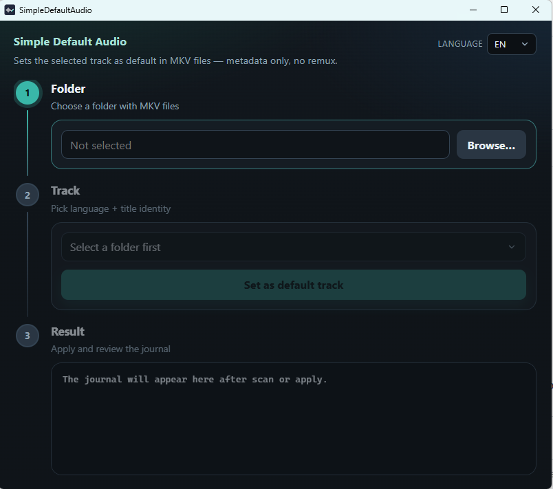
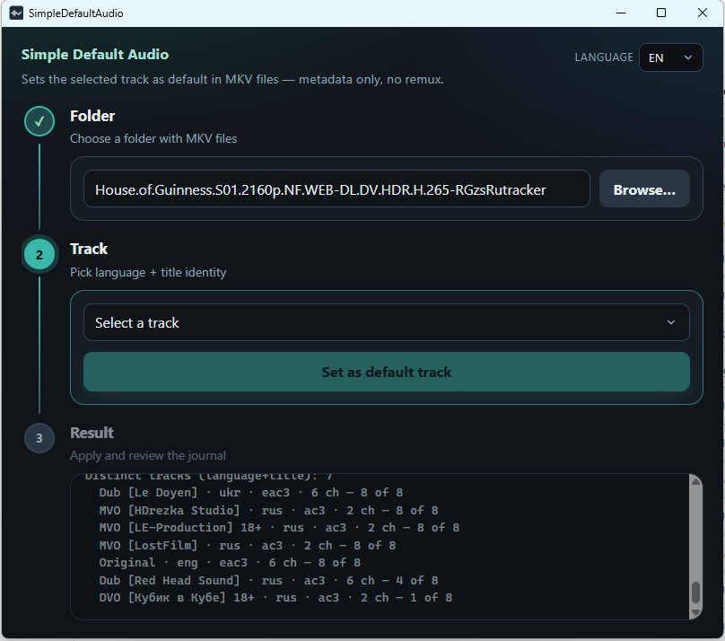
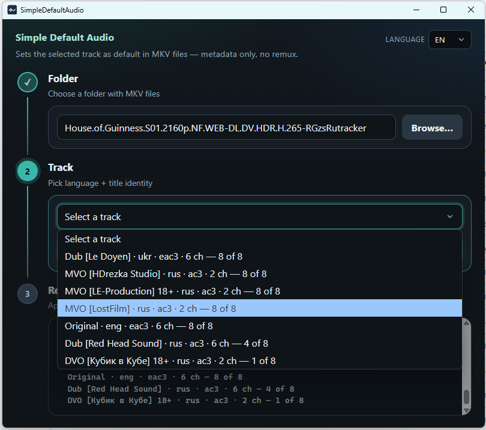
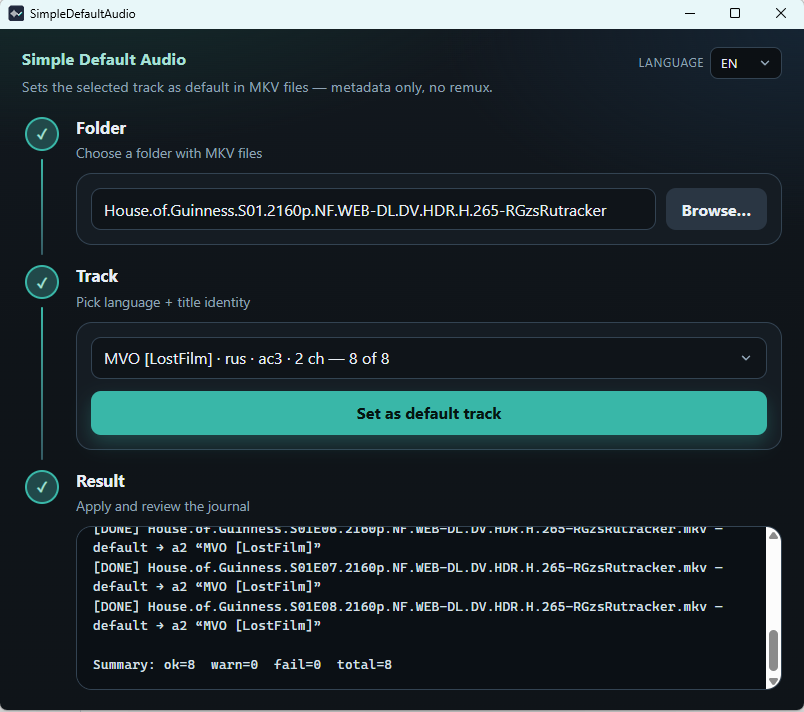

# SimpleDefaultAudio

**English** | [Русский](./README.ru.md)

**Lightweight desktop utility** that sets the **default audio track** on MKV files — metadata only, no remux, no re-encode.

Pick a folder → choose a track by **language + title** → apply. Matching files update in place; files without that identity are skipped with a journal warning.

| | |
|---|---|
| Platforms | Windows 10/11 (x64 portable), macOS 12+ (zip/dmg, Apple Silicon) |
| License | [MIT](./LICENSE) |
| Downloads | **[GitHub Releases](https://github.com/fckreg/simple-default-audio/releases)** only |

## Screenshots

| Empty start | Folder scanned |
|---|---|
|  |  |

| Pick a track | Apply result |
|---|---|
|  |  |

## Download

1. Open **[Releases](https://github.com/fckreg/simple-default-audio/releases)**
2. Get the asset for your OS:
   - Windows: `SimpleDefaultAudio.exe` (portable)
   - macOS (Apple Silicon): `SimpleDefaultAudio-mac-arm64.zip` or `.dmg`

Binaries are **not** committed to this repository. Always use Releases.

## Why is the Windows build large?

Typical portable size is driven by:

1. **Electron / Chromium** runtime (~80–110 MB compressed)
2. **Bundled `ffprobe`** (media header probe; essentials build preferred)
3. **Bundled `mkvpropedit`** (~10–12 MB)

This is normal for a download-and-run Electron app that ships helpers so users need no system installs.

## Why does Windows warn on first launch?

The portable `.exe` is **not code-signed** with an Authenticode certificate. Windows SmartScreen / Defender SmartScreen therefore shows “Windows protected your PC” for unknown publishers. Click **More info → Run anyway** (or unblock in Properties). Signing requires a paid certificate and is not part of v1.

## macOS first open (unsigned builds)

v1 macOS builds are **unsigned / ad-hoc** (no Apple Developer notarization).

1. Download and unpack the zip (or open the DMG).
2. Move **SimpleDefaultAudio** to Applications (recommended).
3. First launch: right-click the app → **Open** → confirm **Open**.  
   Or: System Settings → Privacy & Security → allow the blocked app, then open again.
4. If still blocked:

```bash
xattr -dr com.apple.quarantine /Applications/SimpleDefaultAudio.app
```

## What it does

- Scans `.mkv` files in the selected folder (no subfolders)
- Lists distinct audio options by **normalized language + title**
- Sets `flag-default` via bundled `mkvpropedit` (headers only)
- UI languages: **EN (default)** and **RU**
- Streams a readable journal; continues after per-file skips/errors
- Ships with bundled `ffprobe` + `mkvpropedit`

## Develop

```bash
npm install
npm run fetch-binaries   # populates resources/bin/<platform-arch>/
npm run dev
```

### Package (local)

```bash
npm run pack:win   # Windows portable
npm run pack:mac   # macOS zip/dmg (on macOS)
```

Output goes to `release/` (gitignored). Do not commit binaries.

### Helper binaries

`npm run fetch-binaries` downloads helpers into `resources/bin/`:

| Target | Notes |
|--------|--------|
| `win32-x64` | FFmpeg **essentials** + MKVToolNix portable |
| `darwin-arm64` / `darwin-x64` | Copy from Homebrew `ffmpeg` + `mkvtoolnix` |

See [THIRD_PARTY_NOTICES.md](./THIRD_PARTY_NOTICES.md).

## Contributing

Issues and PRs welcome. Keep the product focused: folder → track → default audio on MKV.

## Changelog

See [CHANGELOG.md](./CHANGELOG.md).
