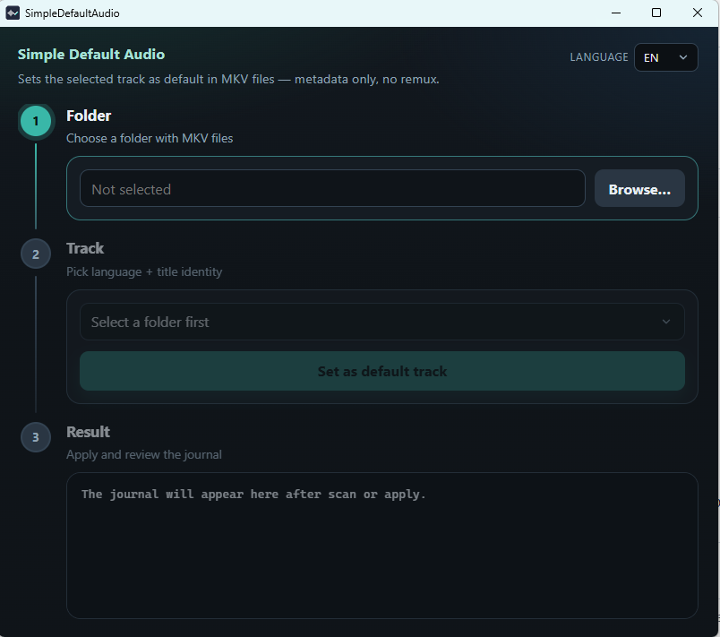
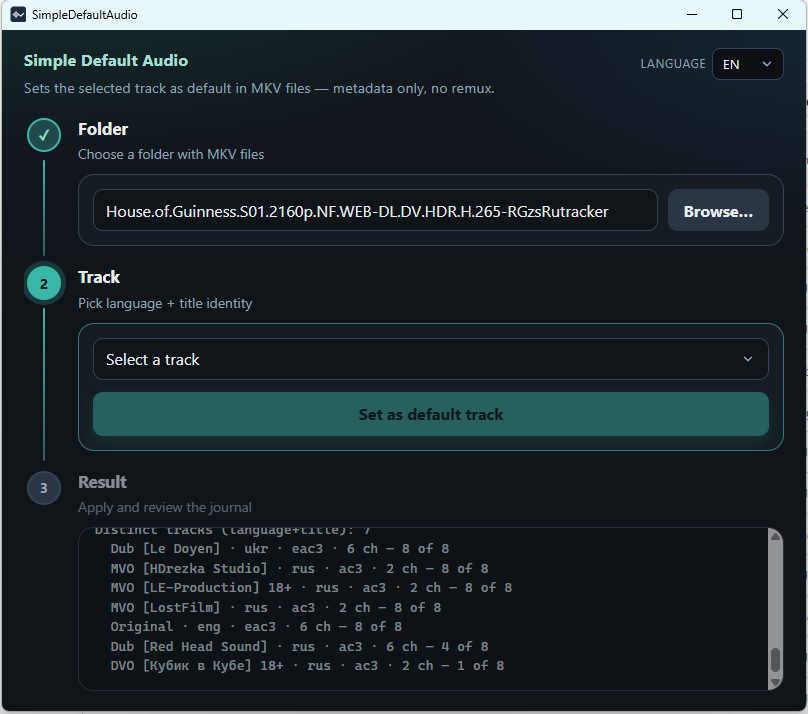
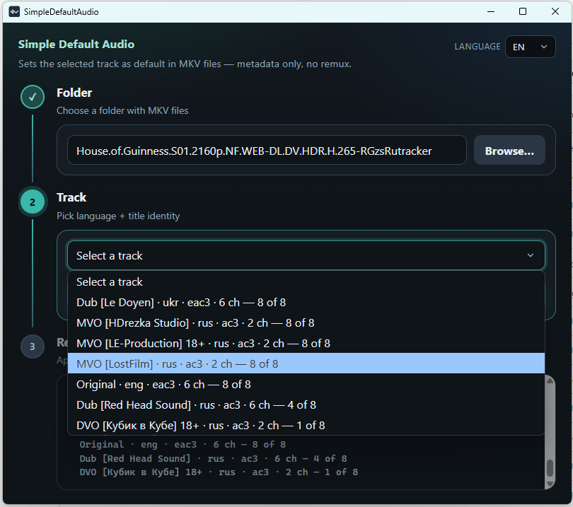
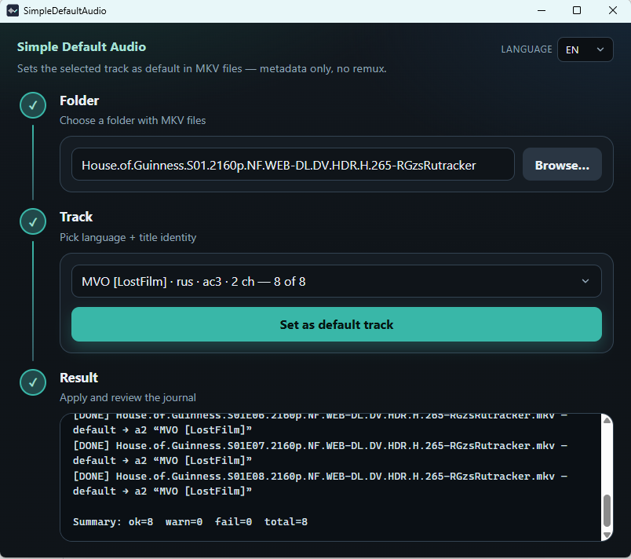

# SimpleDefaultAudio

[English](./README.md) | **Русский**

**Лёгкая десктопная утилита**, которая ставит **аудиодорожку по умолчанию** в MKV — только метаданные, без remux и перекодирования.

Выберите папку → выберите дорожку по **языку + названию** → примените. Подходящие файлы обновляются на месте; файлы без такой дорожки пропускаются с предупреждением в журнале.

| | |
|---|---|
| Платформы | Windows 10/11 (x64 portable), macOS 12+ (zip/dmg, Apple Silicon) |
| Лицензия | [MIT](./LICENSE) |
| Скачать | Только через **[GitHub Releases](https://github.com/fckreg/simple-default-audio/releases)** |

## Скриншоты

| Старт | Папка просканирована |
|---|---|
|  |  |

| Выбор дорожки | Результат |
|---|---|
|  |  |

## Скачать

1. Откройте **[Releases](https://github.com/fckreg/simple-default-audio/releases)**
2. Возьмите файл для своей ОС:
   - Windows: `SimpleDefaultAudio.exe` (portable)
   - macOS (Apple Silicon): `SimpleDefaultAudio-mac-arm64.zip` или `.dmg`

Бинарники **не** хранятся в git. Всегда скачивайте из Releases.

## Почему Windows-сборка большая?

Типичный размер portable складывается из:

1. **Electron / Chromium** (~80–110 MB в сжатом виде)
2. **Встроенный `ffprobe`** (чтение заголовков; предпочтительно essentials)
3. **Встроенный `mkvpropedit`** (~10–12 MB)

Это нормально для Electron-приложения «скачал и запустил» со своими хелперами.

## Почему Windows ругается при первом запуске?

`.exe` **не подписан** Authenticode-сертификатом. SmartScreen показывает «Windows защитила ваш компьютер» для неизвестного издателя. Нажмите **Подробнее → Выполнить в любом случае** (или снимите блокировку в свойствах файла). Подпись требует платного сертификата и в v1 не входит.

## Первый запуск на macOS (без подписи)

Сборки macOS v1 — **unsigned / ad-hoc** (без нотаризации Apple).

1. Скачайте и распакуйте zip (или откройте DMG).
2. Переместите **SimpleDefaultAudio** в Applications (рекомендуется).
3. Первый запуск: правый клик → **Открыть** → подтвердите **Открыть**.  
   Или: Системные настройки → Конфиденциальность и безопасность → разрешите заблокированное приложение.
4. Если всё ещё блокирует:

```bash
xattr -dr com.apple.quarantine /Applications/SimpleDefaultAudio.app
```

## Что умеет

- Сканирует `.mkv` в выбранной папке (без подпапок)
- Собирает варианты дорожек по **нормализованным языку + названию**
- Ставит `flag-default` через встроенный `mkvpropedit` (только заголовки)
- Языки UI: **EN (по умолчанию)** и **RU**
- Живой журнал; после ошибки на одном файле продолжает остальные
- Поставляется с `ffprobe` + `mkvpropedit` внутри

## Разработка

```bash
npm install
npm run fetch-binaries   # заполняет resources/bin/<platform-arch>/
npm run dev
```

### Сборка (локально)

```bash
npm run pack:win   # Windows portable
npm run pack:mac   # macOS zip/dmg (на macOS)
```

Результат в `release/` (в git не коммитится).

### Вспомогательные бинарники

`npm run fetch-binaries` кладёт хелперы в `resources/bin/`:

| Цель | Примечание |
|------|------------|
| `win32-x64` | FFmpeg **essentials** + MKVToolNix portable |
| `darwin-arm64` / `darwin-x64` | Копия из Homebrew `ffmpeg` + `mkvtoolnix` |

См. [THIRD_PARTY_NOTICES.md](./THIRD_PARTY_NOTICES.md).

## Участие

Issues и PR приветствуются. Держите продукт узким: папка → дорожка → default audio в MKV.

## Changelog

См. [CHANGELOG.md](./CHANGELOG.md).
